

  
  <h1>Pinecone</h1>
  

    A comfortable home for your books, documents, comics, and audiobooks on Android.
  

## Screenshots

Current development app, captured at 1080 × 2400 on the Resizable (Experimental) emulator.

| Library | Shelves | Book details |
| --- | --- | --- |
| 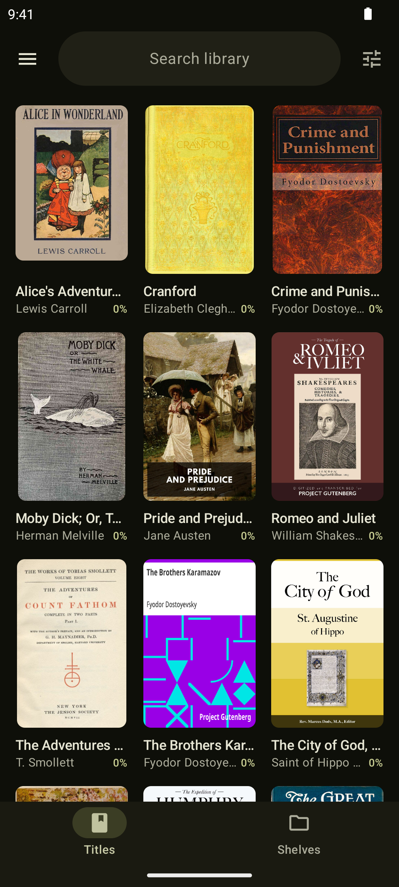 | 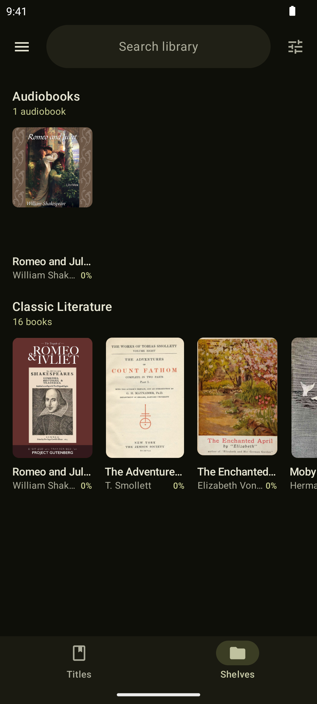 | 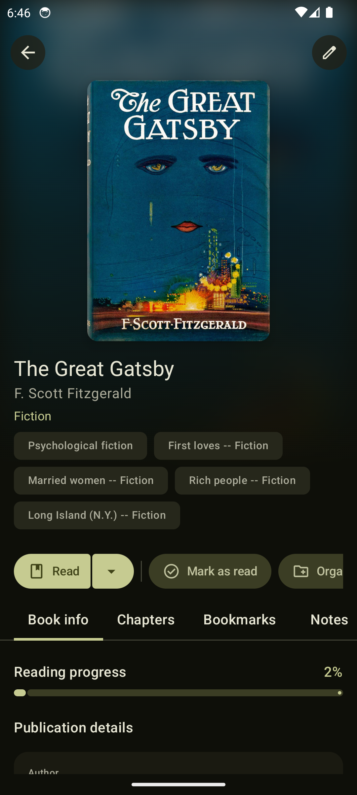 |

| EPUB reading | Original PDF | PDF converted to EPUB read mode |
| --- | --- | --- |
| 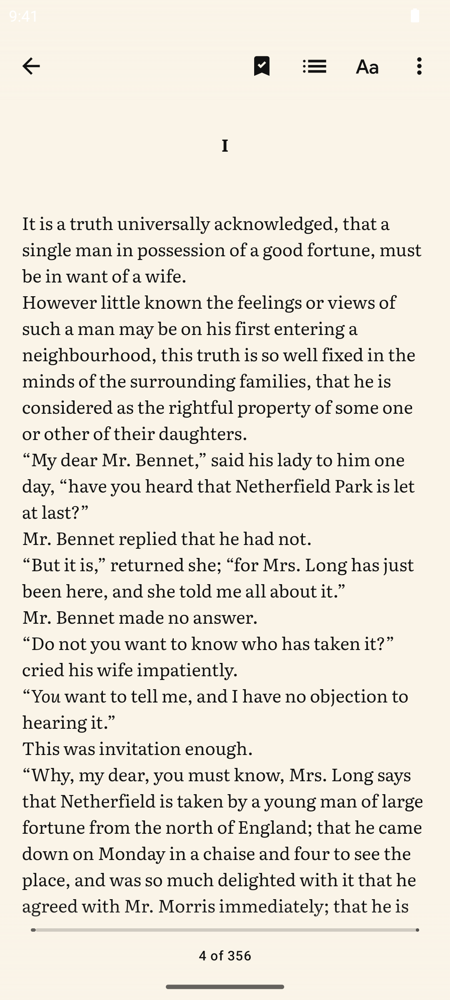 | 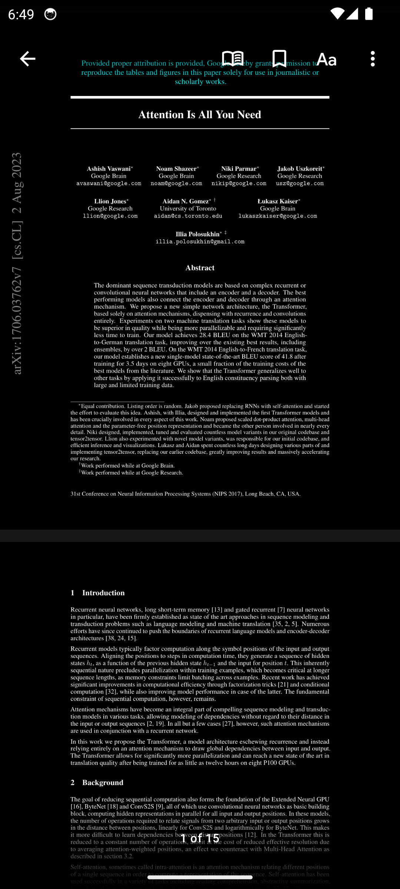 | 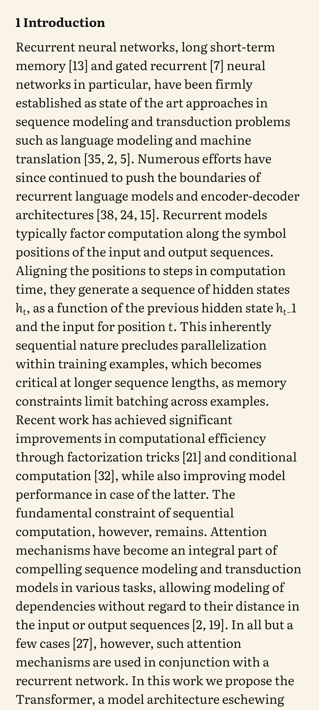 |

PDF read mode keeps the original available and supports reading customization. Scanned pages remain
images; OCR is not supported.

| Audiobook playback | Offline dictionary | Reader customization |
| --- | --- | --- |
| 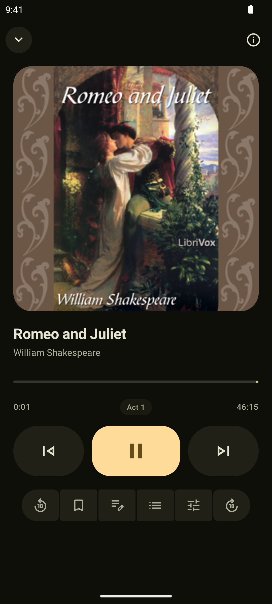 | 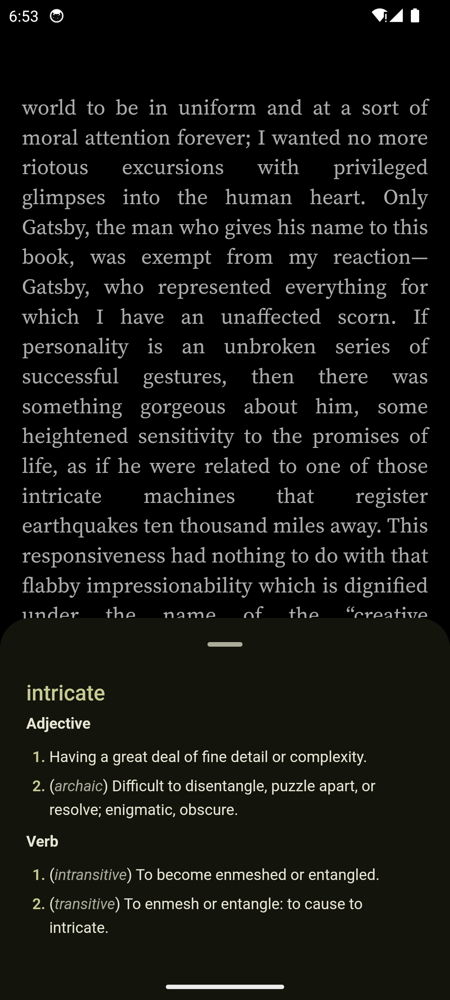 | 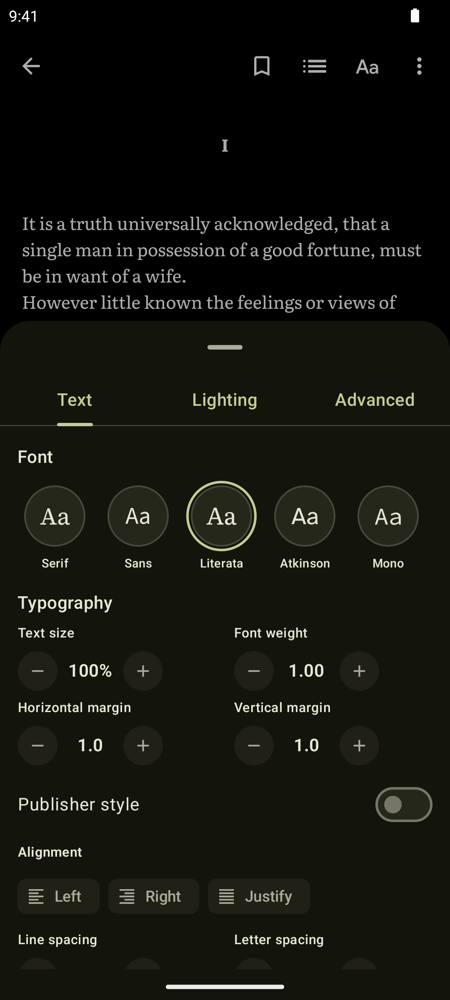 |

More features: search, organization, annotations, appearance and backups

| Library search | Spaces | Bulk selection |
| --- | --- | --- |
| 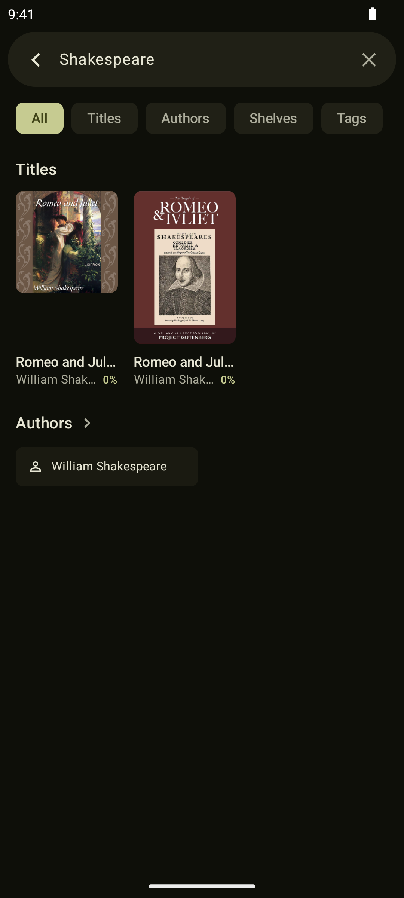 | 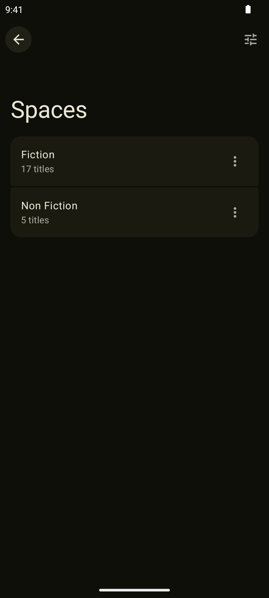 | 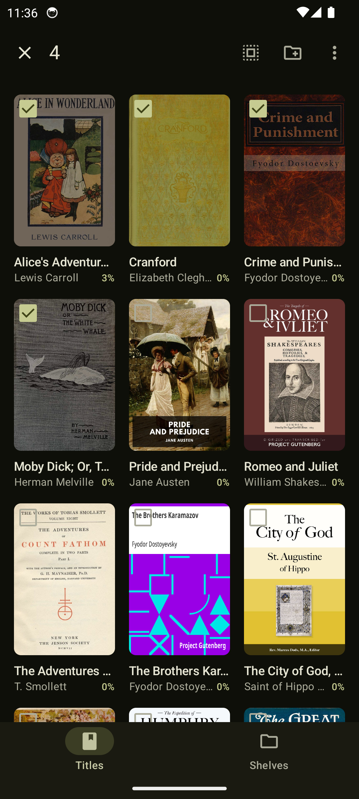 |

| Shelf membership | Notes and highlights | Converted PDF chapters |
| --- | --- | --- |
| 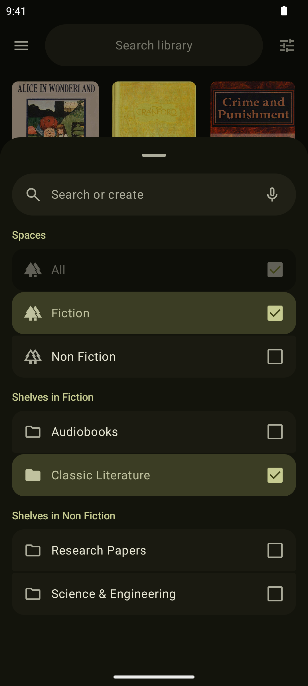 | 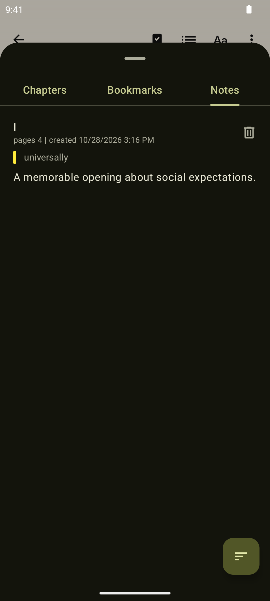 | 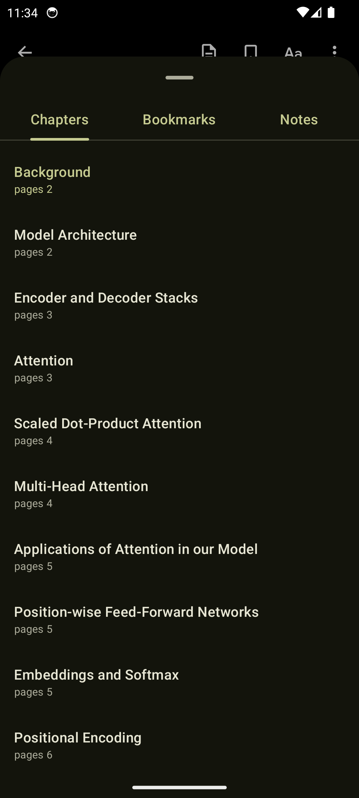 |

| Playback settings | App appearance | Backup and restore |
| --- | --- | --- |
| 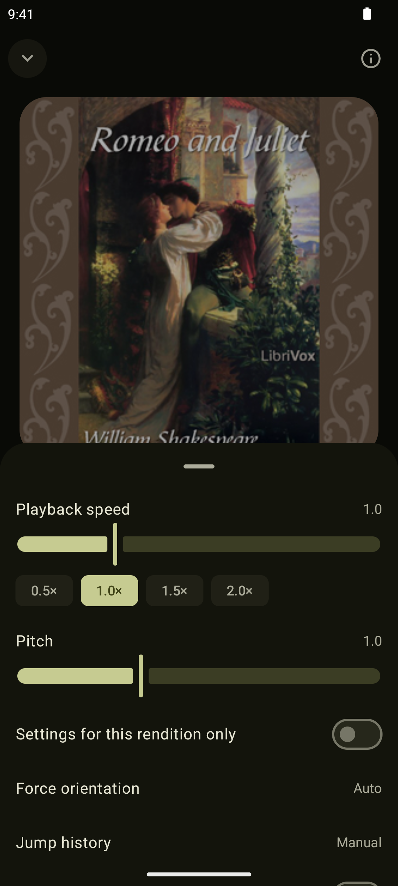 | 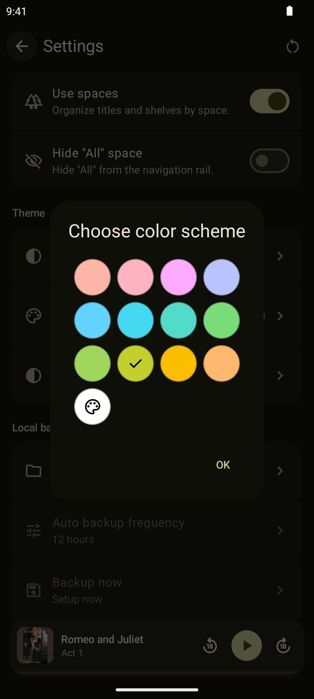 | 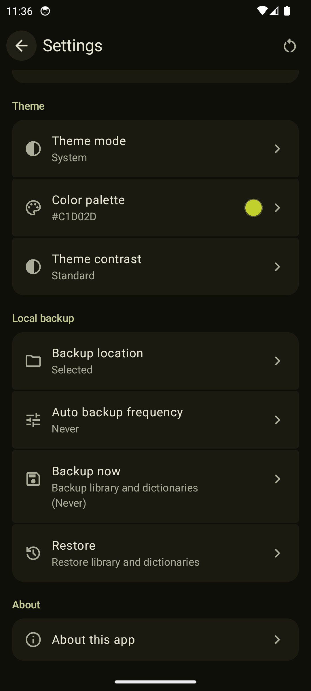 |

Screenshot content and artwork retain their original rights; see [asset sources](docs/ASSET_SOURCES.md).

## Made for your reading life

**Bring your collection together.** Import EPUB books, PDFs, CBZ comics, images, and audiobooks from your device. Browse covers, search your library, and find titles with filters for format, reading status, and shelf.

**Make the library your own.** Arrange titles in shelves and separate spaces, edit book details and covers, and organize several titles at once. Keep new imports in an Unsorted inbox or archive books you want to set aside.

**Read comfortably.** Choose fonts, text size, spacing, colors, and brightness to suit you. Open a PDF in its original layout or switch to a reflowable reading view made on your device. Scanned pages remain images; OCR is not supported.

**Remember and discover.** Pick up where you left off, save bookmarks, notes, and highlights where supported, and search inside EPUB books and PDFs. Import an offline StarDict dictionary to look up words as you read.

**Listen your way.** Play audiobook packages or supported audio files, move between chapters, skip forward or back, and adjust playback speed. The mini player keeps controls within reach while you browse.

**Keep your library safe.** Create manual or scheduled local backups and restore your library, dictionaries, settings, and reading progress. Choose a light or dark theme, a color palette, and an English or Indonesian interface.

Pinecone requires **Android 14 or newer**.

## License

Pinecone is distributed under a single license, **AGPL-3.0-or-later**, with no alternative license
offered. Copyright (C) 2026 Javier Aahmes Reansyah. See [COPYING](COPYING) for the full license
text. Dependency licenses and links are available in the app's About section.
