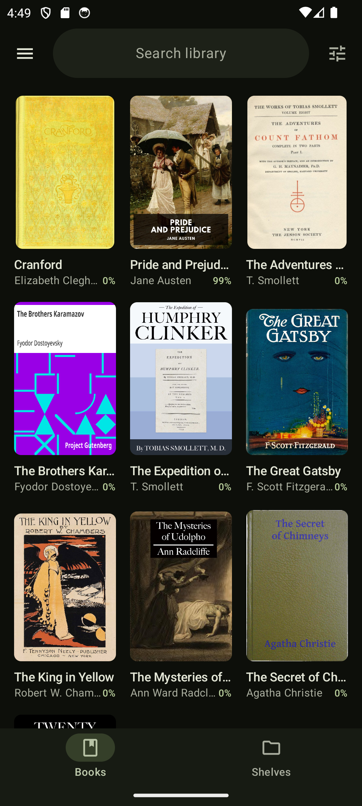
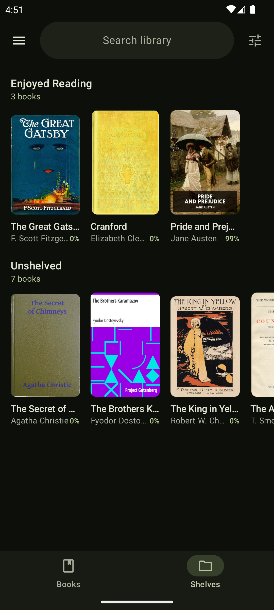
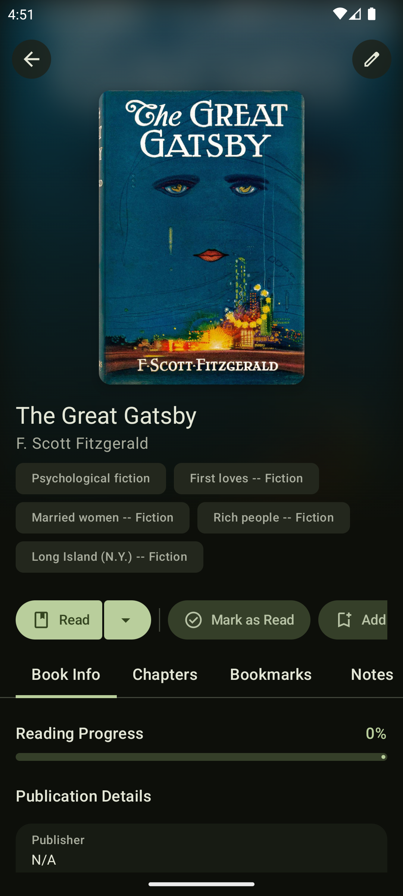
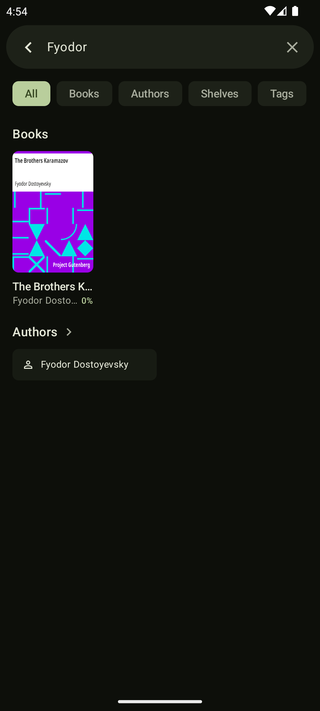

<div align="center">
  
  <h1>Pinecone</h1>
  <p>
    Pinecone is a modern Android publication reader that combines Material 3 Expressive design with Readium navigators and MuPDF for a customizable reading and listening experience.
  </p>
</div>

## Screenshots

<div align="center">
  
  
  
  
  
  
  
</div>

## Features

- **Multi-format:** Readium navigators for reflowable/fixed-layout EPUB, PDF, CBZ/image
  publications, audiobook packages, and supported standalone audio.
- **PDF read mode:** An on-device MuPDF pipeline reconstructs text and illustrations into EPUB 3.
  Switch using the reader header. Complex vector graphics use a labeled original-page image
  fallback; scanned pages remain images (no OCR). Reading order and semantic reconstruction are
  best-effort.
- **Rich metadata:** Ordered contributor roles, series, issue/volume, languages, identifiers, and
  ComicInfo.xml import, with metadata editing.
- **Material 3 Expressive:** Designed according to the latest Material 3 Expressive design
  guidelines for a beautiful and modern interface.
- **Dynamic Colors & Palettes:** Enjoy deep personalization with Material You dynamic colors,
  curated color palettes, and adjustable contrast levels.
- **Library Management:** A complete library management system. Use powerful custom filters,
  organize your books into shelves, or move finished books to the archive.
- **Multi-Selection:** Select multiple books at once to quickly add them to shelves, mark them as
  read, or delete them in batches.
- **Notes & Highlights:** Keep track of your favorite quotes and thoughts by adding highlights and
  notes directly to your books.
- **Dictionary & Translation:** Look up definitions and translate text without ever leaving the
  reader.
- **In-book Search:** Quickly search for phrases and navigate smoothly through search results within
  the book.
- **Typography & Custom Fonts:** Enhance readability by choosing from a curated selection of
  beautiful fonts like Atkinson Hyperlegible, Literata, Source Code Pro, Source Sans 3, and Source
  Serif 4.
- **Customizable Reader:** Tailor the reading layout to your liking with adjustable font sizes,
  themes, and reading modes.
- **Backup & Restore:** Secure your library data, settings, and reading progress with local manual
  and automatic backups.

## Local publication import

Import files or scan folders. For an unpackaged Readium manifest, select its folder containing
`manifest.json` and all referenced resources; Pinecone copies them into a self-contained package.
Remote manifests/streaming, CBR, DRM/LCP, and OCR are not supported. Readium's WebPub/Divina support
is partial; image and audio codecs also depend on the renderer/platform.

PDF and generated EPUB renditions share one library item, but retain separate locators, annotations,
and optional reader settings. Generated renditions and source-page maps are durable backup assets,
not disposable caches.

### Development data reset

This development revision starts a fresh Room v1 database named
`publication_library`; no migration from `reader_database` is provided. Backup
vault/snapshot/portable formats are now v2. Old v1 backups are not importable. Keep old
installations/backups separately if you need their data. The old database and its asset directories
are not deleted by this revision.

## License

AGPL-3.0-or-later; see [COPYING](COPYING) and [LICENSE.md](LICENSE.md), including the
corresponding-source obligations for the bundled MuPDF native engine.

## Validation

From the repository root in Windows PowerShell:

```powershell
# Quick: debug build and JVM unit tests
.\gradlew.bat :app:assembleDebug :app:testDebugUnitTest --warning-mode all
```

For **Complete** validation (all build types, JVM tests, and Android lint), see
[VALIDATION.md](VALIDATION.md). IDE recommendations are handled manually in JetBrains tools.
