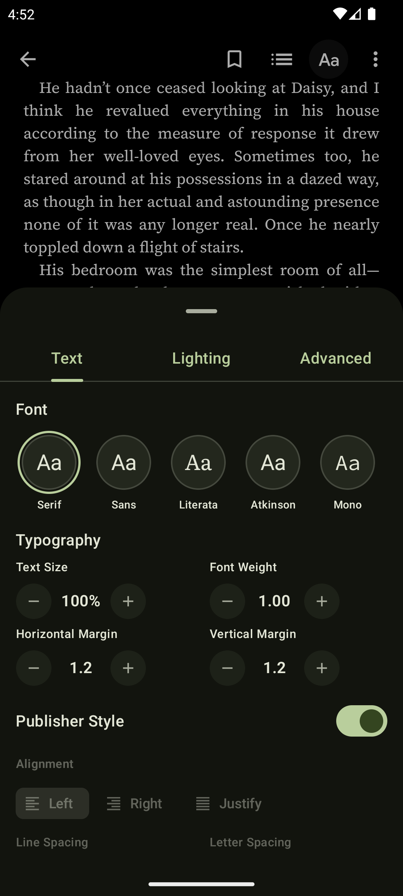
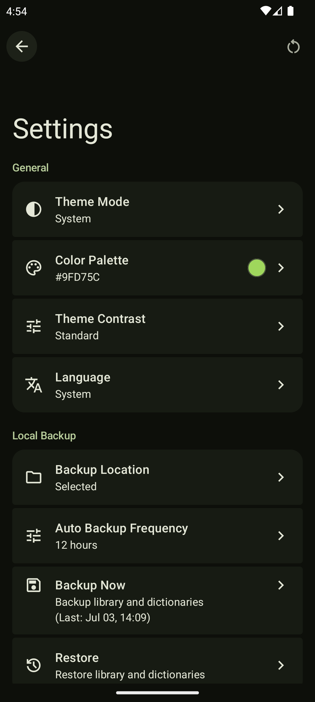

  
  <h1>Pinecone</h1>
  

    Pinecone is an Android reader for books, documents, comics, and audiobooks, with Material 3 Expressive design and customizable reading and listening.
  

## Screenshots

  
  
  
  
  
  
  

## Features

- **Books, documents, comics, and audiobooks:** Read EPUB books, PDF documents, CBZ comics, image
  publications, and audiobook packages, or listen to supported standalone audio files.
- **PDF read mode:** Switch between the original PDF and a reflowable reading view generated on your
  device. Scanned pages remain images; OCR is not supported.
- **Audiobook playback:** Play and pause, seek, skip forward or back by 10 seconds, and adjust
  playback speed. Embedded audio tags supply titles and authors when available.
- **Spaces and shelves:** Organize titles into optional spaces and shelves. Create shelves in
  multiple spaces, and move or copy shelves between spaces.
- **Library browsing:** Search titles, authors, shelves, and tags; switch between grid and list
  layouts; and filter by format, reading status, or shelf membership.
- **Reading status and archives:** Track progress, mark titles as finished, archive them, and
  optionally keep new imports in an Unsorted inbox until organized.
- **Bulk organization:** Select multiple titles to organize, mark as read, archive, or delete.
- **Publication details:** View and edit titles, contributors, descriptions, covers, languages,
  identifiers, and comic volume and issue metadata, including imported ComicInfo.xml fields.
- **Bookmarks, notes, and highlights:** Save passages and reading positions, then revisit them from
  the reader or title info page where supported by the format.
- **Search within publications:** Find text in EPUB books and PDF documents and jump to matches.
- **Offline dictionaries:** Import StarDict dictionaries and look up selected words while reading.
- **Reading customization:** Adjust typography, spacing, colors, brightness, and reading options,
  with settings suited to each format.
- **Material 3 Expressive:** Use dynamic colors or curated palettes, light and dark themes,
  adjustable contrast, and English or Indonesian interface text.
- **Local import and backups:** Import individual files or scan folders, create manual or scheduled
  backups, and restore your library, dictionaries, settings, and reading progress.

## License

Pinecone is distributed under a single license, **AGPL-3.0-or-later**, with no alternative license
offered. Copyright (C) 2026 Javier Aahmes Reansyah. See [COPYING](COPYING) for the full license
text. Dependency licenses and links are available in the app's About section.
