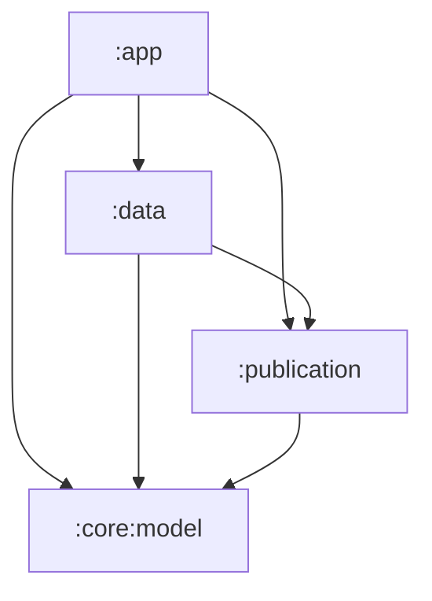

# Architecture audit and refactoring handoff

## 1. Purpose and status

This document records the architecture review and the agreed direction for Pinecone's next
refactoring work. It is intended to survive a new AI session and support implementation in small,
reviewable increments. It contains findings, decisions, proposed interfaces, sequencing, recovery
rules, and acceptance criteria. Proposed types and modules below do not exist unless a completed
work entry explicitly says otherwise.

| Item | Baseline |
| --- | --- |
| Review date | 2026-10-25 |
| Reviewed HEAD | `9956f9e` — Restore audiobook playback and simplify Hilt ownership |
| User's historical reference | `9586179`; review also covered subsequent architecture changes |
| Production source inventory | 199 Kotlin/Java files, approximately 40,000 lines |
| Repository at handoff | One Android application module, `:app` |
| Implementation status | WP1–WP7 implemented; WP8 has synthetic query/native measurements, with representative UI/physical-device profiling still open; see latest implementation log and ARCHITECTURE_PERFORMANCE.md |
| Original review validation | Quick passed; unit-test task was up to date |
| Existing unit-test reports | 227 tests, zero failures/errors across 37 suites |
| Unperformed review validation | Device tests, runtime profiling, lint, IDE inspections, Complete |

The review used repository-wide searches and detailed tracing of DI, persistence, imports,
conversion, playback, navigation, and ViewModels. Static inspection identifies possible races and
repeated work; it does not prove their runtime frequency or quantify a performance improvement.
Do not describe this review as a benchmark or as proof that every execution path is correct.

### User decisions to preserve

1. A larger, staged redesign is acceptable when it improves ownership, simplicity, and future
   maintainability. This is not authorization for an unbounded rewrite.
2. Book imports and PDF conversions should become durable background operations: leaving the
   screen must not cancel them, and normal Android process death must permit safe recovery.
3. When conversion finishes after the reader closes, reopening that book should select the
   converted read-mode rendition. The request must therefore be persisted.
4. Existing reading, organization, playback, and portable-backup behavior should otherwise remain
   compatible.

### Read these existing instructions first

- [AGENTS.md](../AGENTS.md) is the source of repository execution and validation instructions.
- [DEPENDENCIES.md](DEPENDENCIES.md) explains existing ownership decisions and intentionally retained
  custom implementations. This plan supplements it; it does not erase those decisions.
- [VALIDATION.md](VALIDATION.md) applies when the user requests broader validation. Do not run or
  claim Complete just because this is a broad architecture plan.

Default validation from the repository root, using Windows PowerShell:

```powershell
.\gradlew.bat :app:assembleDebug :app:testDebugUnitTest --warning-mode all
```

Fix build/compiler errors and warnings and failing tests introduced or exposed by the work, then
rerun Quick. Quick does not include lint or IDE inspections and does not establish that all warnings
are cleared. Device UI testing must use **Resizable (Experimental)**, never **Medium Phone**.
Preserve unrelated user changes. This document itself does not instruct an agent to commit, publish,
or change release credentials.

## 2. Instructions for the next AI iteration

1. Read this document, current `AGENTS.md` files, and the latest implementation log below.
2. Inspect `git status`, current HEAD, and changes since the reviewed baseline. Re-find symbols by
   name; source line numbers from the original review are not durable references.
3. Verify that the selected finding still applies. Later changes may already resolve it or change
   its implementation. Update the finding rather than implementing an obsolete fix.
4. Choose the first unfinished work package whose prerequisites are satisfied. Complete one
   cohesive package, or an explicitly requested subset, before widening the change.
5. Add focused tests for the behavior being changed, especially concurrency, ownership, persistence,
   and compatibility. Do not add tests that only mirror a trivial implementation.
6. Run required validation. Record the exact command, result, and any checks not run. Cached results
   must be described as cached/up-to-date rather than freshly executed tests.
7. Update the package checklist and implementation log with changes, remaining work, evidence,
   and new findings. Do not mark a package complete because its files were merely moved.
8. End with a concise report of what changed, why, validation, and remaining material limitations.

Do not repeat the whole audit on every iteration. Revalidate relevant findings and their callers.
Do not mistake a proposed interface sketch for an already available API. Framework APIs and
background-execution rules must be checked against the versions installed when implementation
occurs.

## 3. Architecture at the reviewed baseline

Production paths in this document are relative to
`app/src/main/java/com/javierreansyah/pinecone/`, unless prefixed otherwise. These are baseline
audit locations. After WP4, storage/repositories live under `data/src/main/java/`, publication
processing and native PDF geometry under `publication/src/main/java/`, and neutral models under
`core/model/src/main/kotlin/`, preserving their package names. See the latest implementation entry.

| Subsystem | Main entry points | Current ownership |
| --- | --- | --- |
| Application and DI | `PineconeApplication.kt`, `di/AppModule.kt`, `di/DatabaseModule.kt`, `di/ReadiumModule.kt` | Hilt singleton graph; application scope for process-lifetime work |
| Library persistence | `data/repository/library/LibraryRepository.kt`, `data/local/database/library/` | Singleton repository, Room database and DAOs |
| Settings | `data/local/preferences/PreferenceStores.kt`, `ReaderPreferences.kt`, `LibraryPreferencesManager.kt` | Typed JSON DataStores with legacy migrations; singleton wrappers |
| Publication processing | `data/publication/`, `data/publication/conversion/` | Shared Readium services; callers own opened publications |
| Visual reader | `ui/features/reader/ReaderActivity.kt`, `ReaderViewModel.kt`, `NavigatorController.kt`, `EpubNavigatorController.kt` | Activity/navigation presentation; ViewModel retains publication state |
| PDF rendering | `reader/pdf/MuPdfDocument.kt`, `MuPdfDocumentFragment.kt`, `PdfTextOverlay.kt` | Explicit native ownership, synchronized document access, view-owned producers |
| Audio playback | `reader/audio/AudioPlaybackService.kt`, `AudioPlaybackEngine.kt`, `AudioPlaybackClient.kt`, `AudioPlaybackState.kt` | Service owns native playback; singleton client/store expose process-local state |
| Backup | `data/repository/backup/BackupRepository.kt`, `worker/BackupWorker.kt`, `worker/WorkerUtils.kt` | Singleton repository, operation mutex, Hilt worker |
| Cross-system mutations | `domain/DeleteBooks.kt`, `domain/RestoreBackup.kt` | Coordinate acknowledged playback shutdown before changing assets |
| Navigation and organization | `ui/root/NavGraph.kt`, `AudioPlayerSheet.kt`, `ui/features/library/organize/` | Navigation 3 decorators for entries; organization sheet currently uses ambient owner |

### Hilt assessment: retain the successful migration

The central Hilt wiring is largely correct:

- `@HiltAndroidApp` and activity/service entry points are present.
- Repositories predominantly use constructor injection.
- Application-scoped databases, preference wrappers, Readium services, audio client, and
  presentation store have appropriate shared ownership.
- `AudioPlaybackEngine` is `@ServiceScoped`; UI and application components do not own its native
  player or publication.
- Assisted ViewModel factories supply runtime publication IDs or selections. This is supported
  Hilt usage, not evidence that the migration is incomplete.
- `BackupWorker` uses `@HiltWorker` and assisted worker arguments. The application supplies
  `HiltWorkerFactory`, and the manifest removes WorkManager's default Startup initializer.
- Navigation entries generally use their decorated ViewModel stores and class-derived default
  keys. Preserve the earlier fix for reader/notes key collisions.

Do not inject every value object, pure function, temporary converter helper, or presentation
controller. A constructor requiring a live lifecycle owner or fragment manager can legitimately be
called by the presentation owner. Introduce DI at ownership and substitutability boundaries.

The preference delegates already enforce one DataStore per file. The default
`LibraryPreferencesManager(context, ReaderPreferences(context))` construction is a hidden wrapper
dependency to simplify later, not proof of duplicate DataStore instances.

## 4. Findings register

Priority meanings: **P1** is a correctness/resource/data-consistency risk to address first; **P2** is
substantial maintenance or known repeated-work improvement; **P3** requires measurement or belongs
to separate release work. Priorities are not claims of reproduced user incidents.

### F01 — Cover replacement bypasses asset coordination (P1)

**Evidence:** `LibraryRepository.updateBookMetadata()` reads a book, creates a custom cover directly
in the final covers directory, deletes the old cover before the Room transaction, and does not use
`storageMutex`. A null `openInputStream()` result can still be followed by assigning the new path.

**Risk:** orphan cleanup can collect the new unreferenced file, failed persistence can leave the old
reference pointing at a deleted cover, and a failed source open can produce a nonexistent reference.

**Required outcome:** stage and verify the replacement; publish its reference under shared asset
coordination; preserve the old cover until commit; remove only unreferenced, unleased old files.
Treat failure to open/copy the source as failure. Never report successful cover replacement after
silently retaining or losing the previous file.

### F02 — Stale whole-row updates can overwrite unrelated changes (P1)

**Evidence:** metadata reads the book before file work, then later writes `bookDetailsBook.copy(...)`.
`toggleArchive()` and `toggleReadStatus()` read and update in separate calls. Playback/reader progress
also updates the book row.

**Risk:** metadata or status operations can restore stale progress, timestamps, or flags. Concurrent
toggles can lose an operation.

**Required outcome:** update only edited columns, use atomic SQL toggles, and use explicit batch
setters for bulk actions. Related authors/tags/credits must commit together. Reading-position and
rendition projections must remain consistent in one transaction. Read any necessary current values
inside that transaction, not before slow file work.

### F03 — Recovery has no shared initialization barrier (P1)

**Evidence:** application recovery starts asynchronously. UI entry points can start normal work
before it completes. `BackupRepository.completePendingSettingsRestore()` accesses recovery state
without acquiring `operationMutex`, although restore calls it while holding that mutex.

**Risk:** startup recovery and a user restore can operate on the same journal/settings concurrently.
One failure in the sequential startup coroutine can also skip later unrelated startup effects.

**Required outcome:** serialize recovery with restore, expose initialization state, and gate normal
entry-point work until critical recovery finishes. Use a public locking wrapper and a private
already-locked implementation; do not recursively acquire a non-reentrant coroutine mutex.

### F04 — Publication acquisition and closure are inconsistent (P1)

**Evidence:** `LibraryRepository.openPublication()` returns an owned `Publication` from
`withContext(ioDispatcher)` without cleanup if cancellation discards the returned value.
`BookInfoViewModel` closes its temporary publication only on the normal successful path.

**Risk:** resources can leak on cancellation/exception. Old session jobs can finish after a
rendition change and publish obsolete results.

**Required outcome:** explicit cancellation-safe acquisition/handoff, `try/finally` for temporary
publications, generation-checked results, and dependent-job cancellation/join before final closure.
Use `MuPdfDocumentFactory`'s existing cancellation-aware handoff as a reference, not as justification
to make entire open/conversion operations non-cancellable.

### F05 — Dictionary lifetime is outside the injected graph (P1)

**Evidence:** `DictionaryDatabase` stores a static `ConcurrentHashMap` and constructs values with
`getOrPut`. Lookup obtains a database/DAO while delete, backup, and restore independently call
`closeDatabase()`.

**Risk:** competing construction can allocate an unused database, and closure/replacement can race
an in-flight lookup. A thread-safe map does not coordinate the lifetime of its values.

**Required outcome:** one injected dictionary owner, scoped use of a dictionary, exclusive close or
replacement, and coordinated temporary snapshots for backup. Do not expose closable cached
databases to independent consumers.

### F06 — Dictionary import failure leaves resources/state behind (P1)

**Evidence:** `StardictParser` closes its mapped-file channel only after successful parsing; failed
imports can leave a database registered without an installed-dictionary preference. The comment
claiming garbage collection will close it conflicts with the registry's strong references.

**Required outcome:** structured channel cleanup, bounded/validated reads, cancellation checks,
cleanup of unpublished databases, and a terminal import state after cancellation/failure. Serialize
concurrent imports or give them independent state; a single progress flow cannot faithfully
represent multiple independent imports.

### F07 — The obsolete reconstruction pipeline remains in main sources (P2)

**Evidence:** production `PdfReadModeConverter.convert()` uses `MuPdfPageExporter`,
`MuPdfReflowProfile`, `MuPdfReflowCleaner`, and `EpubWriter.nativePage()`. `PdfLayoutExtractor` is
called only by optional instrumented audit tooling; `PdfLayoutReconstructor` is called only by tests.

The old group spans approximately 1,400 lines before legacy writer branches:

- `PdfLayout.kt` — old page/profile/reconstruction models and algorithm.
- `PdfLayoutExtractor.kt` and `PdfGraphicsDevice.java` — old extraction support.
- `PdfTableReconstructor.kt`, `PdfListReconstructor.kt`, `PdfBibliographyReconstructor.kt`.
- Legacy `EpubWriter.page()`, image/source/math/table writer branches and their models.

**Required outcome:** migrate useful assertions to the active pipeline, update research audit dumps,
then remove the obsolete production path. `FigureBounds` and active source-map/locator compatibility
are shared behavior to retain. Recheck all references before removal. R8 may already eliminate some
unused code in release; the immediate benefit is less source and misleading test coverage, not a
promised APK-size or runtime improvement.

### F08 — Library queries and transformations repeat work (P2)

**Evidence:** library/filter/shelf/collection ViewModels independently load related full collections,
map `BookWithDetails` to `Book`, decode metadata JSON, and filter/sort in Main-backed ViewModel flows.
Category summaries repeatedly filter books for each author/tag/space. Some `SharingStarted.Lazily`
flows keep collecting once started until their retained ViewModel is cleared.

**Required outcome:** stable shared inputs within each ViewModel, one-pass membership indexes,
injected Default dispatcher for substantial transformations, and targeted queries for inbox/shelf
details. Deduplicate relevant settings and data before expensive mapping. Retain whole-collection
selection/count/sort semantics; this is not a mandate to add Paging or an unbounded global cache.

### F09 — Composables rebuild filtering flows (P2)

**Evidence:** `ShelfDetailScreen` maps entities into `flowOf` and calls
`getFilteredAndSortedBooks(...)` during composition. `FilterResultScreen` also creates a filtering
flow from a method call during composition.

**Required outcome:** route arguments configure the entry's ViewModel, which exposes stable
screen state. Recomposition does not recreate the upstream query/filter pipeline. Shelf detail
queries the selected shelf rather than materializing every shelf with every related book.

### F10 — Cover decoding does not follow display bounds (P2)

**Evidence:** `CoverImage` and `AutoWidthCoverImage` call `rememberAsyncImagePainter` without a size
resolver. Library prewarming uses explicit 400x600 requests that need not match actual requests.

**Required outcome:** constraint-aware decoding through `AsyncImage` or an explicit size resolver,
preserving contain/cover behavior, natural aspect ratio, placeholders, and accessibility text.
Align prefetch and visible requests so prewarming does not cause a second oversized decode.

### F11 — HTML views reload on unrelated recomposition (P2)

**Evidence:** `HtmlWebView` always calls `loadDataWithBaseURL()` in `AndroidView.update`. Its JavaScript
bridge captures the factory-time callback. HTML memoization omits whether a word-click callback
exists even though that controls injected script generation.

**Required outcome:** reload only when rendered content changes; keep callback references current;
update JavaScript/bridge enablement when its configuration changes. Preserve jsoup cleaning,
description formatting, theme changes, and `onRelease` destruction. Do not trade sanitation for speed.

### F12 — Organization ViewModels outlive their sheets (P2)

**Evidence:** `NavGraph` obtains an organization ViewModel outside the navigation-entry decorators,
with a distinct `organize:$bookIds` key. The ambient owner is the activity, so dismissal does not
clear each selection-specific ViewModel.

**Required outcome:** use a sheet-specific decorated Navigation 3 entry, removed on dismissal. Its
owner survives legitimate recreation and clears on dismissal. Use typed selected IDs rather than
CSV as the new interface. Keep model-type/instance key isolation; do not reintroduce audio keys
shared between different ViewModel classes.

### F13 — Completion and lookup state can misrepresent work (P2)

**Evidence:** category/filter-result mutation methods call `onSuccess` before launching persistence.
`ReaderDictionaryViewModel` starts independent lookup coroutines without superseding old requests.

**Required outcome:** publish success after commit, expose write errors, cancel older lookups, and
check request identity before applying results. Dismissal invalidates pending lookup results. Keep
Unicode letters/combining marks rather than reducing dictionary words to ASCII `\w` characters.

### F14 — Settings effects have fragmented ownership (P2)

**Evidence:** startup and settings UI separately schedule backups; restoring settings does not
immediately schedule the restored frequency. The application checks `unsortedEnabled` on every
settings emission. Audio combines full rendition rows with settings, decoding overrides and
submitting preferences even when only reading position changed.

**Required outcome:** one scheduler observes distinct scheduling settings; a distinct inbox setting
drives release of unsorted books. Project and deduplicate override JSON before decoding, and submit
audio preferences only when effective audio settings change. Preserve persisted settings as the
source of truth.

### F15 — Database evolution is not preservation-safe by default (P2; future data-loss risk)

**Evidence:** database builders use destructive migration fallback. Both reviewed schemas are
version 1. Dictionary synonym resolution queries `dictionary_entries.wordIndex` without an index.

**Required outcome:** explicit preserving migrations and exported schema history. Add the index
with a dictionary migration, and add operation tables with a library migration. `dropAllTables = false`
does not make a destructive fallback safe for user-owned library data. Never edit an already-shipped
version-1 schema in place and assume the fallback will repair a same-version identity mismatch.

### F16 — Blocking operations, cancellation, and bulk work need consistency (P2)

**Evidence:** MainViewModel does URI metadata queries on its caller's Main coroutine;
DictionaryRepository deletes/closes files on its caller's context; backup has broad exception
handlers; copy/parse loops can do extensive work without cancellation checks. Batch deletion invokes
single-book deletion repeatedly, rebuilding global reference information for each item.

**Required outcome:** main-safe I/O boundaries, cancellation propagation, bounded loops, `finally`
cleanup, and explicit batch operations. Some outer coroutine boundaries already rethrow cancellation;
do not claim every current catch suppresses it. Inspect the actual path being changed.

### F17 — Remaining performance candidates require measurements (P3)

- PDF pages render at a fixed requested width and are rendered again after disposal/re-entry.
- PDF opening loads every page's bounds to reserve correct layout dimensions. This intentionally
  prevents distant jumps from being clamped by tiny placeholders; preserve that behavior.
- Search progressively copies growing result lists and remaps highlights. Measure large documents
  before choosing bounded publication intervals or caching.
- Conversion performs multiple native exports and XML/JSON work. Preserve order, bounded memory,
  native thread-safety, reconstruction quality, and source-map identity before changing algorithms.
- Precompile repeated regexes in genuinely hot loops after the active pipeline is isolated.

Do not add PDF caches, more native parallelism, alternative renderers, or different reconstruction
heuristics without a baseline and regression fixtures. No optimization percentage is promised.

### F18 — Release configuration needs separate attention (P3)

`app/build.gradle.kts` signs release with the debug configuration and derives version codes from
the current clock. Production signing needs explicit credentials/configuration; wall-clock inputs
also reduce reproducibility and cause packaging work between otherwise identical builds.

Keep this separate from architecture correctness. Do not generate replacement production keys,
change signing identity, or reduce version codes as an incidental cleanup. A later release task
should use explicit monotonically increasing version inputs and supplied signing configuration.

## 5. Compatibility and non-negotiable invariants

### Persistence and backups

- Preserve database filenames and all user-owned library/dictionary data.
- Preserve the existing settings files and migration markers; legacy files remain available for
  recovery. Do not re-run legacy import after a completed migration.
- Incremental settings changes use DataStore transforms against current durable values. Full
  replacement is reserved for intentional restore/reset operations.
- Portable backup JSON continues to contain the existing `ReaderSettings` shape, not a new internal
  storage envelope or local operation queue. Preserve serialized field names and defaults when
  moving Kotlin types across packages/modules.
- Preserve `{}` as disabled per-book settings. An enabled default-valued override remains distinct
  and must not fall back to global audio settings.
- Preserve revision tracking, pending-settings restore, journal recovery, object verification,
  retention, and partial-result behavior while splitting the backup implementation.
- Jobs, attempt tokens, staging paths, and local library generation are operational state, excluded
  from portable backups and from library-content revision triggers.

### Publications, locators, and navigation

- Preserve original assets, supported formats, metadata precedence, edited metadata, and local-only
  resource validation.
- Keep original/read-mode progress, settings, annotations, and source mappings separated correctly.
- Previously generated EPUBs and their persisted anchors/locators remain readable after old writer
  code is removed. Retain compatibility readers/remappers even when old generation code disappears.
- Preserve the converter version unless generated semantics actually change. Do not invalidate every
  cached rendition merely because code moved into another module.
- Preserve source-page geometry, mixed page sizes, PDF selection/search coordinates, custom shelf
  order, global-space/inbox behavior, bulk selection, and archived-item mutation semantics.
- Retain custom predictive Back behavior and Navigation 3 entry decorators. Default navigation is
  not a proven replacement for the tested exit-flight behavior.

### Playback and lifetimes

- Audio engine/publication/navigator/player remain service-owned. UI must not open a duplicate audio
  publication to obtain metadata or contents already supplied by the service snapshot.
- Preserve acknowledged audio stop before destructive asset mutations and exclusion of new opens
  during the protected mutation interval.
- Preserve Media3 controller transport, generation checks, custom locator/link commands, and
  notification/system controls.
- Visual-reader and conversion resources also need leases before destructive mutation. Do not
  weaken audio coordination while adding visual-reader coordination.
- Coroutine cancellation is not an ordinary failure result. Use short non-cancellable cleanup or
  commit windows only where needed for ownership and recoverability.

## 6. Target modules and dependency rules

Extract four modules after correctness fixes and obsolete-code removal:

| Module | Type and contents | Allowed project dependencies |
| --- | --- | --- |
| `:core:model` | Kotlin/JVM shared library, publication, preference, and operation DTOs; serialization | None |
| `:publication` | Android library: Readium opening, metadata extraction, native MuPDF access, active conversion | `:core:model` |
| `:data` | Android library: Room, DataStore, assets, dictionaries, repositories, backup persistence | `:core:model`, `:publication` |
| `:app` | Android app: UI, navigation, ViewModels, playback service/client, workers, cross-system orchestration | The three modules above |



### Resolve these current reversals before moving files

1. Move persisted library filter/sort models and `ALL_SPACES_ID` out of UI ownership.
2. Separate serializable PDF settings data from `Configurable.Preferences` and other Readium
   interfaces. Keep engine adapters beside reader integration; preserve the JSON shape.
3. Metadata import returns neutral credit/metadata records, not `PublicationCreditEntity`.
   Persistence maps those records into Room entities.
4. Shared library models must not expose Room entities such as `SpaceEntity` and
   `PublicationCreditEntity`. Introduce neutral records and keep entity conversion in `:data`.
5. Native document access/conversion belongs to `:publication`; `MuPdfDocumentFragment`, Compose
   overlays, app theme integration, and navigation adapters remain in `:app`.
6. Relocate module-owned resources and schema output deliberately. Preserve relevant package and
   database identities; source movement alone does not justify a schema migration.

Use the existing version catalog. Add library/JVM plugins compatible with the installed toolchain;
do not upgrade dependencies as an unrelated part of extraction. Apply Hilt/KSP where generated
bindings are needed and verify the app can aggregate library bindings. Do not create a module per
screen or helper in this iteration.

## 7. Responsibility and interface design

The following are proposed boundaries. Adapt spelling to repository conventions while retaining
the stated ownership and behavior. Avoid generic base repositories, base use cases, and forwarding
interfaces with no useful boundary.

### Repositories and publication access

- `LibraryRepository`: library queries, edited metadata, organization, explicit status changes, and
  batch operations. It does not own native reader sessions or playback.
- `ReadingRepository`: positions, jump origins, notes/bookmarks, rendition state, per-rendition
  preferences, and their atomic persistence rules.
- `PublicationRepository`: import preparation, opening via publication services, generation, and
  asset publication. Delegate filesystem ownership to the asset store rather than duplicating it.
- `BackupRepository`: public snapshot/list/import/export/restore behavior. Extract vault/object I/O
  and restore recovery into cohesive collaborators while keeping results and archive format stable.
- Feature-facing interfaces get one injected implementation and `@Binds` where useful for fakes.
  Keep Room DAOs internal to persistence. Do not wrap every DAO method in a new interface.
- Keep Readium types at publication/reader boundaries when they are the actual needed API; do not
  recreate the entire Readium type hierarchy merely to claim framework independence.

Representative additions include explicit `setArchived(ids, value)`, `setReadStatus(ids, value)`,
batch organization methods, selected-shelf/inbox queries, and stable reading-preference flows.
Use atomic SQL for single toggles. Chunk bound parameter lists to the installed SQLite limit while
retaining a transaction for the complete batch.

### Asset store and leases

One singleton asset owner coordinates committed publication/cover files and temporary preparation:

1. Preparation writes to an operation-owned staging location outside ordinary final-asset cleanup.
2. Readers and conversion tasks acquire leases for the immutable asset identity they use.
3. The short mutation section validates current records/generation, publishes a completed file,
   commits references, and registers superseded files for later collection.
4. Rollback deletes newly owned unpublished output, never a pre-existing shared file.
5. Collection removes only files with no durable reference, no active lease, and no resumable job
   ownership. A database snapshot alone is insufficient to identify every active staging file.
6. Expensive conversion, hashing, provider I/O, and compression do not hold the global commit lock.

Do not replace immutable files in place while a native/WebView reader uses them. Active readers of
a superseded rendition can finish detaching before the old asset is collected. Deletion invalidates
affected presentation and cancels affected operations; restore invalidates all old-library sessions.

### Coordination order and deadlock prevention

- A maintenance coordinator excludes new destructive/opening operations during restore and makes
  cancellation/invalidation visible before the replacement begins.
- Request cancellation and acknowledged session shutdown **before** taking low-level commit locks.
  Never join a worker while holding a lock that worker needs to complete cleanup.
- Backup/recovery serialization surrounds journal work. Dictionary exclusive access surrounds
  dictionary snapshot/replacement, and asset mutation coordination surrounds reference publication.
- When multiple such locks are required, establish and document one order: maintenance admission,
  backup operation serialization, dictionary coordination, asset commit coordination, Room
  transaction. Acquire multiple dictionary IDs in deterministic sorted order.
- Do not acquire higher-level coordination from inside a Room transaction or progress callback.
  Stream copied backup objects from temporary snapshots/asset leases without holding a Room
  transaction across provider I/O.
- Before extracting a helper, document whether it expects a lock to be held. Public wrappers acquire
  locks; private `...Locked` implementations do not acquire the same mutex again.

### Dictionary owner

Provide scoped operations such as `withDictionary(id)`, an exclusive snapshot-to-temp-file operation,
and exclusive replacement/deletion. Lookup cannot retain a raw DAO beyond the scope. The owner
creates at most one cached handle per ID, coordinates outstanding use, and explicitly closes it.

For backup, wait for current uses, checkpoint/close safely, copy a stable local snapshot, then release
exclusive dictionary access before compression or remote/provider writes. Do not close a Room
database from inside its active transaction. Failed import closes/deletes its unpublished database;
publishing installation preferences occurs only once the dictionary is usable. Preserve existing
restore journaling for dictionary swaps and recovery.

### Publication sessions and reading settings

- Give each opened visual publication a session generation and owned coroutine job tree.
- Serialize open/switch requests. Results from an old generation cannot replace positions,
  publication, search, or settings of the current generation.
- Stop/join dependent operations and detach presentation before closing retired publications.
  Temporary book-info metadata loading always closes in `finally`.
- Acquisition code retains ownership until dispatcher handoff succeeds; cancellation during handoff
  closes the acquired resource. Do not hide lengthy acquisition inside blanket `NonCancellable`.
- Centralize per-rendition setting decode/merge/update. Map rendition rows to `preferencesJson`,
  deduplicate, then decode. Submit audio speed/pitch only when those effective values change.
- Keep mutable session flows private where feasible and expose read-only state to presentation.
- Final position flushes must complete at relevant lifecycle/session boundaries before closing;
  do not launch a final save into a scope that is already being cancelled.

### Startup and settings effects

Expose initialization as loading, ready, or recoverable failure. Critical recovery completes before
entry points start normal mutations or open sessions. Gate at activity/service/worker boundaries;
do not blindly add `awaitReady()` to every repository method because recovery itself calls them.

Release the splash to a recoverable screen when initialization fails. Preserve corrupted settings
and journals for retry/recovery; do not silently reset user state. Noncritical cleanup runs after
critical recovery and cannot disable independent settings observers.

One injected scheduler observes persisted backup frequency with `distinctUntilChanged()`. Remove
imperative scheduling from settings UI and restore callbacks once observation owns it. Observe
`unsortedEnabled` independently rather than executing a release query for every unrelated settings
change. Use the existing application scope with supervised independent jobs and actionable errors.

## 8. Durable operation design

### External behavior and minimal API

Book-file import, publication-folder scanning/import, and PDF read-mode generation use persistent
operations. Dictionary import is not automatically a new durable-job feature; fix its ownership and
failure cleanup first. Manual backup UI behavior remains separate unless explicitly expanded later.

An operation API must provide:

```kotlin
// Proposed contract sketch, not an existing API or final framework signature.
suspend fun enqueueImport(request: ImportRequest): OperationId
suspend fun enqueueReadMode(bookId: String, forceReparse: Boolean): OperationId
fun observeOperation(id: OperationId): Flow<OperationSnapshot>
suspend fun cancelOperation(id: OperationId)
```

Requests use typed IDs and input descriptors. Do not pass ViewModels, publications, callbacks,
large URI lists, source maps, or archive content through WorkManager `Data`. Workers receive only
the operation ID and load durable inputs from persistence.

### Local persistence

Add Room records for an operation and its import inputs/items. Required information:

| Record | Required information |
| --- | --- |
| Operation | ID, kind, state, creation/update times, expected library generation, work identity/current attempt, progress, cancellation request, terminal error/result summary |
| Import item | Operation ID, stable item ordinal/identity, persisted URI or staged path, source display name, item state, imported book ID or failure |
| Conversion request | Book ID, original source identity/hash, converter version, force-reparse intent, desired rendition, generated result identity |
| Local coordination state | Library generation incremented by restore; not portable user content |

Use explicit states covering preparing input, queued, running, cancellation requested, success,
partial success, failure, cancellation, and input requiring reselection. Worker/platform interruption
is not the same as a user cancellation. Persist enough information to make that distinction.

Operation states, result summaries, and committed library changes must agree after a crash. A
worker attempt can commit only if its operation, library generation, cancellation status, and
attempt identity are still current. Never let an obsolete attempt resurrect a deleted book or
overwrite a restored library.

### URI access and the acceptance boundary

- Replace the multi-file `ACTION_GET_CONTENT` contract with `ACTION_OPEN_DOCUMENT` while preserving
  multiple selection, supported MIME types, and existing navigation behavior.
- Retain read grants actually supplied by the provider. Persist tree grants for durable scans.
- A transient external `ACTION_VIEW` grant cannot be assumed to survive process death. Copy its
  input into app-owned durable staging before reporting that the import has been accepted as a
  durable job.
- If the process dies before transient input staging completes, retain a truthful interrupted/input
  required result. Do not promise recovery of bytes the app never durably obtained.
- Revoked access, missing files, and unavailable providers produce actionable per-item results.
  Do not endlessly retry permanent input failures.
- Do not retain grants indefinitely without ownership accounting, or release a grant another active
  job still needs. Clean staged input after its terminal operation no longer needs retry data.

### Scheduling, restart, and idempotency

1. Persist the operation before enqueueing uniquely named work, for example
   `publication-operation:<operationId>`.
2. Reconcile resumable records with WorkManager on startup. This closes the crash window between
   inserting an operation and enqueueing it. Re-enqueue only when no active request owns it.
3. Claim an attempt conditionally. An older stopped attempt cannot commit after a new attempt starts.
4. Preserve successful import items and skip them on restart. Existing content-hash deduplication
   remains effective for a crash after book commit but before item bookkeeping.
5. Restart an interrupted conversion from its original source for the initial durable-job version.
   Mid-page or writer checkpoint/resume is explicitly deferred; it adds substantial state to the
   ordered two-pass pipeline. Keep the previous usable rendition throughout the restart.
6. Commit output identity and operation completion consistently. A forced reparse retried after its
   successful commit must recognize that completion rather than generating another rendition.
7. Deduplicate active generation requests for the same book. Store the source/converter identity so
   app updates or changed inputs cannot publish a stale result.
8. Retry transient I/O failures with backoff and bounded attempts. Validation, permission, malformed
   input, and missing-book failures are terminal until the user supplies new input or retries.
9. Clean incomplete temporary output after cancellation/failure; clean stale attempt staging during
   recovery. Never collect another active attempt's files.

For folder scans, persist discovered item identities so a restart does not reimport completed items.
Bound traversal, check cancellation, and preserve the existing special handling of a folder with
`manifest.json` as one publication. A changing external folder is not an atomic filesystem snapshot;
report missing/changed inputs without duplicating committed imports.

### Foreground work and progress

Use Hilt `CoroutineWorker`s with the current `HiltWorkerFactory`. Long imports/conversions use
foreground execution, cancellation notifications, and the correct `dataSync` service type and
permissions for local import/export/file processing. Verify current manifest/API requirements
against target SDK and installed WorkManager before implementation.

WorkManager is still subject to scheduler quotas and foreground-service restrictions. Persisted
work may wait or restart; it is not guaranteed uninterrupted execution. Force-stop is different from
normal process death and must not be advertised as immediate automatic recovery while the app
remains force-stopped. Handle notification permission through the app's normal user flow.

Room operation state is the durable UI source. Worker progress/notifications mirror it. Persist
progress at bounded intervals or meaningful phase transitions rather than on every byte/native
callback. Never delay cancellation or final terminal state for progress throttling.

### Conversion completion and activation

- Persist desired mode as part of the request. Generation alone must not prematurely activate an
  incomplete or unreadable EPUB.
- Validate generated output, atomically commit rendition metadata/source maps and activation, and
  mark the request complete. Retain original and previous generated assets until safe to collect.
- Map the latest durable reading position, not only the position captured when conversion started.
  Preserve the existing remapping rules for prior read-mode bookmarks, notes, and locators.
- A live reader observes the committed rendition generation, cancels obsolete session work, detaches,
  and opens the new rendition safely. An absent reader simply reopens the persisted active mode.
- Cancellation or failure leaves the previous active rendition and usable annotations intact.
  A background worker never directly manipulates activities, fragments, or a ViewModel.

### Delete and restore interaction

Deletion records cancellation/invalidation for affected jobs and prevents their later commits. Close
affected reader/playback sessions through existing/new coordination, then mutate references. Asset
leases prevent physical deletion while cancellation cleanup still uses an old immutable source.

Restore blocks new old-generation work, cancels queued/running operations, and drains active
sessions/work without holding low-level locks they require. Increment the local library generation
with replacement so an obsolete callback cannot publish into the restored library, even when the
same book ID exists there. Keep operation cancellation bookkeeping separate from portable data.

## 9. Work packages and completion gates

Unchecked boxes mean **not implemented or not yet verified**. Keep each package reviewable; package names describe
logical milestones, not a requirement to combine them into one large patch.

### WP1 — Data consistency and critical recovery

Prerequisite: revalidate F01–F04 against current HEAD.

- [x] Add partial/atomic DAO mutations and batch status setters; stop stale whole-row overwrites.
- [x] Stage cover replacement; protect publication/rollback; retain old cover until commit.
- [x] Serialize pending recovery with restore using non-reentrant-safe wrapper/private methods.
- [x] Add critical startup readiness/recoverable error state and gate activity/service/worker entry.
- [x] Introduce cancellation-safe temporary publication access and resource transfer.
- [x] Fix early success callbacks and operation flags that are not reset in `finally`.
- [x] Add focused failure/concurrency tests and pass Quick.

Gate: failing cover I/O or a concurrent progress update cannot lose previous data; startup recovery
cannot race restore; temporary publications close after failure/cancellation.

### WP2 — Dictionary ownership and preservation

Prerequisite: coordination rules from WP1; preserving schema policy before adding an index.

- [x] Replace static lifetime management with injected scoped/exclusive dictionary access.
- [x] Route lookup, import, delete, backup snapshot, and restore swap through that owner.
- [x] Close parser channels on every path; validate offsets/sizes and clean unpublished databases.
- [x] Add cancellation/request identity to lookup and preserve Unicode input.
- [x] Add the `wordIndex` index with an explicit preserving migration and exported schema.
- [x] Verify concurrent lookup/snapshot/delete, failed import, and existing dictionary migration.

Gate: a consumer cannot close another consumer's live database; failed import leaves no installed
preference pointing at an unusable database and no unowned cached handle/file.

### WP3 — Remove the obsolete conversion path

Prerequisite: production/test reference audit reconfirms F07; capture active output fixtures first.

- [x] Map each legacy test to a production behavior, active-pipeline regression, or obsolete helper.
- [x] Transfer meaningful reconstruction/writer assertions to current records/cleaner/native writer.
- [x] Update optional `dumpLayout` research tooling to inspect the current exported page records.
- [x] Remove old extraction/reconstruction models, classes, and legacy writer branches.
- [x] Retain shared geometry, generated-anchor compatibility, and old-rendition remapping.
- [x] Verify existing generated publications and preserve the active converter/writer implementation.

Gate: tests exercise the path production uses; removal does not require a converter-version bump
when output semantics are unchanged. Do not simply delete a failing regression to finish cleanup.

### WP4 — Boundaries and module extraction

Prerequisite: WP1–WP3, with green validation and retained compatibility fixtures.

- [x] Extract neutral shared models and remove data-to-UI/model-to-engine dependency reversals.
- [x] Separate library, reading, and publication responsibilities and narrow feature-facing APIs.
- [x] Extract cohesive backup vault I/O/recovery collaborators without changing archive semantics.
- [x] Create `:core:model`, then `:publication`, then `:data`; keep UI/playback/workers in `:app`.
- [x] Move schemas/resources/tests to owners without changing persistence identities.
- [x] Verify Hilt/KSP generation and app aggregation across module boundaries.
- [x] Run Quick plus all new modules' relevant unit-test tasks.

Gate: the dependency graph matches section 6, no lower layer imports app UI/entities from an upper
layer, and the app still opens existing data. Every new module has a concrete responsibility.

### WP5 — Persistent operation foundation and durable imports

Prerequisite: asset/coordination boundaries and preserving library schema migration.

- [x] Add operation/input persistence, generation/attempt guards, and public enqueue/observe/cancel API.
- [x] Add Hilt workers, unique scheduling, startup reconciliation, retry classification, and progress.
- [x] Replace file picker/grant handling; safely stage transient external inputs.
- [x] Move file imports and folder scans out of ViewModel-owned lifetimes.
- [x] Persist per-item results and deduplicate restart after interrupted commit.
- [x] Add foreground execution/notifications and cancellation cleanup.
- [ ] Verify navigation away, recreation, normal process death, permission loss, and duplicate inputs.

Gate: accepted durable input survives process recreation; completed imports are not duplicated;
failures/cancellation are truthful and staged assets are not orphan-collected prematurely.

### WP6 — Durable PDF generation and safe activation

Prerequisite: WP5, active conversion only, generation/lease-aware reader sessions.

- [x] Persist generation requests, source/converter identity, force-reparse intent, and desired mode.
- [x] Run conversion in the worker with restart-safe staging and previous rendition preserved.
- [x] Validate output and commit rendition/remapped state/activation/completion consistently.
- [x] Observe activation in live readers; reject late results and close retired sessions safely.
- [x] Integrate cancellation, delete, and restore invalidation; fence old work and lease its immutable inputs before restore replacement (see implementation refinement).
- [x] Verify reopening after background completion uses converted read mode at the mapped position.

Gate: failure/cancellation never destroys a usable prior rendition; killed/restarted attempts cannot
publish twice or resurrect deleted/restored data. Background completion requires no live UI object.

### WP7 — Stable screen state and efficient processing

Prerequisite: stable repository/query boundaries. Independent small fixes may be pulled forward
after WP1 if they do not complicate extraction.

- [x] Expose stable screen flows; remove composable-created filtering pipelines and memoize remaining presentation mappings.
- [x] Query selected shelf/inbox records directly and share mapped inputs within each ViewModel.
- [x] Use one-pass category indexes and injected Default dispatcher for expensive transforms.
- [x] Batch organization/deletion/status writes and calculate reference sets once per batch.
- [x] Centralize distinct backup/inbox/settings effects and deduplicate audio preference submission.
- [x] Constrain cover decoding and align prefetch requests.
- [x] Prevent redundant HTML reloads and stale bridge callbacks.
- [x] Give organization sheets their own decorated entry/store and typed selected IDs.
- [x] Consolidate duplicated collection writes in repository batch actions; retain the existing small
  collection base and screen-specific ViewModels without expanding a universal framework.

Gate: unrelated recomposition does not restart upstream collection or HTML loading; image requests
follow display bounds; relevant data changes still update every screen correctly.

### WP8 — Measured performance follow-up

Prerequisite: WP7 baseline and representative device fixtures.

- [ ] Record library startup/search/sort/scroll, query counts, mapping time, allocations, and cover memory.
- [ ] Run existing conversion benchmark before/after with identical inputs/device/build settings.
- [ ] Profile PDF open, distant-page jumps, backtracking, search accumulation, rendering, and text layers.
- [ ] Implement only optimizations supported by those measurements, with output/behavior regressions.
- [x] Record results and explicitly defer candidates without evidence of useful benefit.

Gate: report actual measurements and their limits. A shorter source file or additional cache is not
proof of faster execution. Preserve native synchronization and the current bounded pipeline.

## 10. Validation matrix

| Area | Required scenarios and assertions |
| --- | --- |
| Metadata/progress | Interleave metadata/cover editing with progress, read/archive, and rendition changes; unrelated fields survive |
| Cover lifecycle | Null input, copy failure, cancellation, database failure, concurrent cleanup/delete; old cover survives failure and references never publish missing files |
| Recovery | Startup versus restore, interrupted journal, pending settings, repeated recovery, corrupt settings; no race, no silent loss, no permanent splash |
| Dictionary | Concurrent acquisition, lookup versus snapshot/delete/restore, invalid index offsets, cancellation, repeated import, preserving index migration |
| Publications | Cancel during dispatcher handoff, throw while loading positions, switch rendition while search runs, close book during open; close once and reject late results |
| Hilt/lifecycle | Shared singleton state, service-only engine ownership, retained entry ViewModels, distinct reader/notes instances, organization store cleared on dismissal |
| Durable imports | Multi-file/folder inputs, duplicate content, process death before/after item commit, revoked grants, missing provider, transient staging interruption, partial success |
| Durable conversion | Process death/retry, duplicate request, force reparse, source/converter change, cancellation, output failure, completion without UI, reopen into read mode |
| Delete/restore | Active audio and visual reader, running/queued jobs, late old-attempt completion, same IDs in restored library, no resurrection or invalid asset access |
| Preferences | Concurrent DataStore edits, once-only legacy migration, enabled-default overrides versus `{}`, restore immediately updates backup scheduling |
| Library semantics | Spaces on/off, `_all_`, inbox, archives, author/writer/tag queries, custom ordering, all sort modes, bulk action counts and results |
| Images/HTML | Contain/cover and natural aspect ratio, small-cell decode bounds, cache reuse, theme update, callback replacement, selection preserved on unrelated recomposition |
| Conversion compatibility | Source anchors, notes/bookmarks, table/formula/list/bibliography behavior, scanned pages, mixed PDF bounds, previously generated EPUBs, portable backup round trips |

Use existing fixtures and tests as starting points:

- `DependencyInjectionTest` and `AudioPlaybackIntegrationTest` for ownership and playback lifecycle.
- `VisibleBooksQueryTest` for existing 5,000-record filtering/sorting equivalence.
- `PreferenceMigrationTest` and `ReadingPreferenceOverridesTest` for storage/override compatibility.
- `ScreenNavDisplayTest` for predictive navigation and disposal timing.
- `PdfReadModeConverterTest`, `MuPdfReflowCleanerTest`, `GeneratedEpubLocationsTest`,
  `EpubPageChunksTest`, and `OrderedPagePipelineTest` for the active conversion path.
- `PdfConversionBenchmarkTest` for optional device measurements and normalized entry/source-map
  digests. Supply real fixture paths through its existing instrumentation arguments.
- PDF search/selection/zoom/navigation device regressions for rendering changes.

After module extraction, Quick must be supplemented with the new module tests, for example:

```powershell
.\gradlew.bat :core:model:test :publication:testDebugUnitTest :data:testDebugUnitTest --warning-mode all
```

These task names are proposed for the planned module types; confirm generated tasks once modules
exist. Do not claim this supplementary command ran against the original single-module repository.
Targeted device testing is separate from a claim of Complete validation. IDE recommendations remain
the user's manual responsibility under `AGENTS.md`.

For performance, use identical fixture/device/build combinations and record warm-up, passes,
timings, query counts, and memory where measured. Compare normalized conversion contents and source
maps, not raw ZIP bytes containing timestamps. Do not compare debug timing directly with optimized
release timing or treat one noisy emulator pass as a reliable improvement.

## 11. Deferred work and decision boundaries

- No automatic replacement of Navigation 3 display behavior, MuPDF, Readium, or the conversion engine.
- No Paging migration until query/selection/reorder semantics and measured benefit justify it.
- No unbounded global query, bitmap, PDF-text, or decoded-metadata caches.
- No conversion page-level checkpoint/resume in the first durable implementation; restart is safe
  and simpler, with completed library/import items retained.
- No portable-backup format revision solely for internal module/job changes.
- No silent preferences reset or destructive library migration as an error-recovery shortcut.
- No dependency upgrades, blanket dependency removals, or automatic dependency-analysis fixes as
  incidental cleanup. Existing direct API dependencies and runtime registrations can be intentional.
- Production signing and explicit release versioning are a separate task with configuration input.
- New product features or changes to supported formats need explicit scope expansion.

If implementation discovers that preserving a stated invariant requires a different approach,
record the evidence and revised design before broadening the change. Resolve routine details
autonomously; ask the user only for materially different product behavior or missing external input.

## 12. Implementation log template

Append an entry after each implementation iteration. Keep the finding register and package boxes
consistent with the entry.

```text
Date / starting HEAD:
Work package and finding IDs:
Changed behavior and ownership:
Files/interfaces/migrations introduced or removed:
Compatibility evidence:
Tests added or updated:
Validation commands and exact results (including cached/up-to-date tasks):
Device/profile and benchmark fixtures, if used:
Checks not run / remaining risks:
Remaining package work:
Recommended next package:
```

### Handoff entry — 2026-10-25

- Baseline architecture audit completed at `9956f9e`.
- Product decisions recorded: staged larger redesign, durable book imports/PDF conversion, and
  persisted activation of converted read mode on completion.
- No refactoring work package is complete. The documentation request does not itself implement
  any of the proposed types, modules, migrations, workers, or fixes.
- Original review Quick passed with cached/up-to-date unit results; saved reports contained 227
  passing tests. No device/profiling/Complete results were established.
- Documentation handoff checks passed: local Markdown links resolve, fenced blocks are balanced,
  and all eight work packages are present. The documentation-only Quick rerun also passed;
  `:app:testDebugUnitTest` remained up to date. No application source was changed.
- Recommended first implementation: WP1, starting with cover publication and partial row updates.

### Implementation entry — 2026-10-26, starting HEAD `9956f9e`

- WP1: added partial metadata DAO updates, atomic toggles/batch status setters, staged cover
  publication and rollback, serialized pending restore, retryable startup coordination, entry-point
  recovery gates, cancellation-safe publication handoff, and post-commit collection callbacks with
  visible failure state. Backup/restore flags now clear in `finally`.
- WP2: introduced `DictionaryStore`, routed lookup/backup/restore/delete through its scoped or
  exclusive access, added a preserving dictionary schema 1-to-2 index migration, and bounded parser
  reads/cancellation/cleanup. Superseded Unicode lookups cannot overwrite current results.
- WP3: removed the unused custom extraction/reconstruction group and legacy writer model branches.
  `EpubWriterTest` now exercises native XHTML, resource graphs, anchors, tables, lists, bibliography
  continuation, SVG capability, supplementary Unicode, and localized labels. Existing active cleaner
  tests cover native reconstruction; obsolete algorithm-private geometry assertions were retired.
  The optional layout dump now exports `MuPdfPageExporter` records.
- Verified unchanged source bodies for `PdfReadModeConverter.convert`, `EpubWriter.nativePage`, and
  `EpubWriter.finish`; converter version remains 20. This is source-equivalence evidence plus device
  regressions, not a before/after performance benchmark or a full external-PDF digest comparison.
- Pulled forward small WP7 fixes: bounded cover request sizing, HTML reload/callback handling,
  distinct backup/inbox effects, and deduplicated audio preference submissions. Broader screen-flow,
  sheet-owner, query, and prefetch work remains.
- Quick and Android-test compilation passed. After retirement of obsolete tests and addition of
  current-path/startup/mutation tests, the unit reports contain 202 tests with zero failures/errors.
- Targeted Resizable (Experimental), API 34 results, run per class:
  `BookMutationTest`: 3 passed; `DictionaryStoreTest`: 4 passed; `DependencyInjectionTest`: 2 passed;
  `AudioPlaybackIntegrationTest`: 9 passed; `PdfReadModeConverterTest`: 8 passed and 2 optional audits
  not run because `pdfPath`/`thesisPath` were not supplied. The connected XML labels the two assumption
  exits as failures although Gradle exits successfully; they are not successful audit executions.
- The pending WP2 dictionary-containing backup/restore and snapshot-overlap check subsequently
  passed in the isolated data instrumentation APK (see WP4 entry below).
- Production Kotlin/Java delta before module extraction: approximately 1,412 fewer lines, including
  new untracked source files and excluding documentation/resources/tests.
- WP4 started with the `:core:model` scaffold; the following entry records its completed extraction.
- Automatic approval review rejected a combined bulk-move/text-replacement command before it ran.
  Continue extraction with small reviewed file patches and boundary checks rather than rerunning
  that bulk command. Gradle scaffold changes preceding it did apply.
- Complete/lint, IDE inspections, optional external-fixture audits, and performance profiling were
  not run. Fresh Gradle configuration exposed upstream deprecation/configuration-resolution notices
  and AboutLibraries GitHub rate limiting; these are not evidence of warning-free Complete validation.

### WP4 implementation entry — 2026-10-26

Ownership now follows the production graph in section 6:

| Owner | Implementation and compatibility details |
|---|---|
| `:core:model` | `Book`, `LibrarySpace`, `PublicationCredit`, `PublicationMetadata`, `ImportedMetadata`, reader/format preferences, filter/sort preferences and enums, coroutine qualifiers. Stored JSON fields/defaults and qualifier names remain compatible. `PdfPreferences` is a neutral persisted record; the app adapts it to `MuPdfPreferences`. |
| `:publication` | Metadata extraction, folder packaging, native MuPDF access/search/text geometry, the active conversion pipeline, generated EPUB/source-map utilities, and their tests. XML/export/cleaner internals remain internal; navigator integration types are public. Generated-content strings have module-owned localized resources. |
| `:data` | Room databases/DAOs/schemas, DataStore/migrations, dictionaries, backup records, startup coordination, and repositories. `BookMapping`/credit mappings keep Room conversion outside shared models. Existing database names, schema identities, preference files and keys are preserved. |
| `:app` | Composition providers for Readium, Android entry points, ViewModels, UI, navigation, playback, workers, and adapters to reader engines. Hilt aggregates the data module bindings. No new forwarding interfaces or base repositories were introduced. |

The old `LibraryRepository` responsibilities are now divided among injected concrete classes:

- `LibraryRepository`: queries, metadata edits, organization, status changes, deletion/collection.
- `ReadingRepository`: rendition preferences/activation, reading positions, jump state, notes and
  bookmarks. Existing transaction behavior was moved intact; generation-aware session writes are
  still a WP6 prerequisite.
- `PublicationRepository`: import preparation, publication opening, read-mode generation and
  atomic rendition publication. It remains in `:data` because it coordinates Room references and
  files; engine processing remains in `:publication`.
- `PublicationAssetStore`: shared asset directories and mutation mutex, injected into both library
  and publication repositories. This establishes one owner; it does **not yet implement leases or
  remove long-running conversion from the mutation lock**. Those requirements in section 7 remain.
- `BackupVault`: provider-tree access and format creation/verification.
- `DictionaryRestoreJournal`: dictionary swap/rollback/restart recovery, called under the existing
  backup serialization and dictionary-exclusive locks. Journal identity/path validation happens
  before mutation, the journal is synced before swapping files, and a malformed journal is retained
  and surfaced through startup recovery instead of silently discarded. The archive format stays 2.
  Bulk object/portable-archive orchestration remains in `BackupRepository`; further splitting should
  follow actual independent responsibilities, not a target line count.

Validation and operational details:

- The documented Quick command now depends on `:core:model:test`,
  `:publication:testDebugUnitTest`, and `:data:testDebugUnitTest` through the app's debug unit-test
  task. Future module tests therefore remain included in Quick.
- Quick passed across all four modules. Reports contain 208 JVM tests (94 app, 21 data, 83
  publication, 10 core model), with zero failures/errors. Four new tests cover dictionary journal
  recovery before/after database commit, malformed journal retention, and rejecting invalid IDs
  before any file move.
- App, data and publication instrumentation APKs compile. Shared test-only Java/Kotlin fixtures
  live in `test-support/src/androidTest/java`; variant source APIs include these only in test APKs.
  A debug-only Hilt entry point supports real-graph reading/publication integration tests without
  adding production application service-locator fields.
- The relocated conversion suite ran on Resizable (Experimental), API 34: 8 passed; the 2 optional
  external-fixture audits remain unrun. The legacy rendition/bookmark/note/preference preservation
  fixture now constructs `PublicationRepository` and `ReadingRepository` directly.
- The new `DictionaryBackupRoundTripTest` passed on that emulator. It uses the isolated data test
  APK, an in-memory library, a separate settings store and a test SAF provider. It verifies that
  snapshot creation waits for a live lookup and that restoring replaces changed dictionary content,
  restores settings, reopens lookup safely and removes the completed restore journal.
- Dependency injection device checks passed after module extraction. Playback and conversion
  regressions were rerun after their repository dependencies changed: 2 DI tests and 9 playback
  tests passed. The relocated conversion suite again had 8 passes and 2 optional assumptions.
  Final repository checks also passed: 3 book-mutation tests and 4 dictionary-store tests.
- The first backup device command returned success with zero executed tests because the test
  provider crashed before discovery. Corrected its manifest and explicit tree grant, reran, and
  verified the XML contains 1 executed test, 0 failures and 0 errors. Future validation must inspect
  test counts as well as the Gradle exit code.
- Existing version-1 library/dictionary schema JSON content and identity hashes match the original
  exports after relocation (only a trailing newline changed). The full production Kotlin/Java delta
  at this stage is approximately 1,145 fewer lines than starting HEAD, including new files/moves and
  excluding tests, resources, build scripts and documentation.
- App staging resolves library release variants using `matchingFallbacks`; release/staging/Complete
  validation has not been run. Quick still excludes lint and IDE inspections. Upstream AGP and
  AboutLibraries configuration/deprecation notices remain documented, not suppressed.

The WP4 entry above is historical. The implementation below supersedes its pending-work list.

### WP5–WP7 implementation entry — 2026-10-26

#### Durable ownership and database compatibility

- Library Room schema is now **2**. `AppDatabase.MIGRATION_1_2` adds operation/input records,
  runtime generation/maintenance/sequence, deletion tombstones and job-owned URI grants. The
  preserving migration is exported under `data/schemas`; a device fixture creates the actual
  version-1 schema, migrates through Room validation, and verifies existing reading/library state.
  Dictionary schema remains 2. Neither database uses destructive migration.
- The portable backup format remains **2**. Device-local operation attempts, grants, generation
  and tombstones are intentionally excluded from portable records. Restoring a backup must never
  restore another device's queued work or URI permissions.
- `PublicationOperations` is the singleton durable API in `:data`: `enqueueImports`, `enqueueScan`,
  `enqueueReadMode`, observation, cancellation, acknowledgement and reconciliation. `OperationScheduler`
  is the one cross-module execution interface; `:app` binds it to `PublicationWorkScheduler`.
  Room is authoritative. WorkManager input contains only the operation ID.
- States are PREPARING, QUEUED, RUNNING and terminal SUCCEEDED/PARTIAL/FAILED/CANCELLED/INPUT_REQUIRED.
  PREPARING means the input has **not yet been accepted durably**. Source names and staged-file
  ownership are persisted before copying; staged input is synced before QUEUED. Interrupted
  preparation requires reselection and cleans its incomplete copies. A process-specific preparation
  token avoids invalidating preparation still active in the same process.
- Every execution claims a new attempt UUID transactionally. Commit callbacks check state, attempt,
  generation, maintenance and deletion sequence. Repeated/superseded executions cannot change the
  winning terminal record. Import item SUCCESS and publication insertion share the same transaction;
  restart skips committed items, and content-hash identity deduplicates repeated input.
- A tombstone sequence prevents an accepted old import from resurrecting content deleted later.
  A new request accepted after deletion can deliberately import that same content again.
- `PublicationWorker` is a Hilt `CoroutineWorker`, scheduled as unique KEEP work named
  `publication-operation:<id>`. Three bounded attempts use exponential backoff for retryable I/O;
  unavailable inputs/permissions become INPUT_REQUIRED. Foreground/startup failure is surfaced after
  retries. The nonexported cancellation receiver changes Room state before cancelling WorkManager.
- Workers use the startup recovery barrier and a dataSync foreground notification with cancellation.
  The main/reader UI observes persisted progress and requests notification permission when relevant.
  Permission denial does not turn an accepted job into a ViewModel coroutine. Android quotas and
  foreground-service restrictions still apply; durable means safe recovery, not guaranteed immediate
  execution or survival of uninstall, clear-data, force-stop, or arbitrary OS/provider restrictions.
- Application startup reconciles queued/running work and the insert/enqueue crash window. Completed
  staging is cleaned, orphan paths are compared canonically, owned unused grants are released and
  acknowledged terminal history older than 30 days is pruned. Normal worker interruption leaves
  work resumable; explicit user cancellation is terminal.

#### Picker, folder scan and grant rules

- The picker uses OPEN_DOCUMENT with read/persistable flags. Existing durable read grants are reused;
  transient file inputs are copied into `files/operation-inputs` before acceptance. Folder scans
  require persistent tree access and otherwise report INPUT_REQUIRED.
- `operation_uri_grants` tracks only permissions acquired by jobs. Active operations share access;
  the final terminal owner releases it. Preexisting user grants and the configured backup tree grant
  are preserved. Never release all persisted permissions during cleanup.
- Scans have visited-URI, 10,000-node and depth-32 bounds. Discovery plus the DISCOVERED marker is
  persisted atomically. Manifest folders retain their names relative to the granted tree: constructing
  `DocumentFile.fromTreeUri` from an arbitrary child URI would reopen the root, so execution explicitly
  walks the persisted names. A missing/renamed folder requires reselection.
- Import preparation failures preserve input names; partial permission failures request reselection.
  Large error lists use lazy rendering. Users reselect failed input to submit a new operation; there
  is no automatic retry loop for terminal invalid input.

#### Files, leases, conversion and restore

- `PublicationAssetStore` now owns process-local, reference-counted leases and leased attempt
  directories. A Readium `LeasedPublication` service releases its file lease on Publication.close.
  Deleting durable references does not remove a file still open in a reader/native converter.
  Later orphan collection removes it after the lease closes. Process death naturally removes leases;
  Room references and recovery staging determine what the next process retains.
- Import copying, hashing, parsing, metadata and cover preparation happen in staging outside the
  global mutation lock. A short lock plus noncancellable Room transaction revalidates ownership and
  publishes unique immutable source/cover paths. Failed commits remove only files that attempt owns.
- Native conversions are serialized by a dedicated conversion mutex, separate from the asset mutex.
  Original source stays leased throughout conversion. The generated EPUB is opened and hashed in
  staging; final publication uses a unique immutable path, without hashing large files in the commit
  lock. The active native converter remains version **20** and its conversion algorithm is unchanged.
- Conversion records persist source SHA-256, converter version and force-reparse intent. Concurrent
  requests for the same active conversion deduplicate. A changed converter requires a new request.
  Prior renditions remain usable on failure/cancellation. Read-mode annotations are remapped before
  replacement; source-PDF locations and IDs remain intact.
- Conversion commit checks operation/source/generation, writes the rendition and remapped state,
  maps the **latest durable source position**, activates read mode, and marks success in one Room
  transaction. It does not require a reader Activity or ViewModel. A cached rendition is revalidated
  under the mutation lock before its commit callback runs.
- Restore raises maintenance and increments generation before replacement, invalidating operations.
  It uses new immutable file paths. Readers retire old sessions; old conversion output cannot commit.
  **Implementation refinement:** generation fencing plus leases replaces a blocking drain of every
  native attempt. An already running native call may finish against its leased old file, then discard
  output. This avoids holding provider I/O or waiting for native work under a global lock.
- Snapshot capture leases referenced publication/cover/rendition files under the asset lock, then
  performs provider I/O outside it. Dictionary access still follows DictionaryStore/journal locking.
  Maintenance is cleared after pending restored settings/recovery complete. Never bypass pending
  recovery merely to make the UI appear ready.

#### Reader and screen lifetime

- `ReadingSessionToken` identifies generation, book, rendition and asset hash. Position, annotation,
  jump and book-settings writes from readers carry a session; stale sessions are rejected during
  maintenance, after mode changes and after replacement. Navigator locator collectors capture the
  publication token rather than reading a later token when an old callback fires.
- Reader identity observes generation, maintenance, active mode and read-mode asset hash. Opening
  cancels/joins the previous open, computes positions before publishing, and closes failed/cancelled
  acquisitions. Null publication state detaches navigators; retired native publications close after
  detach. Audio invalidation similarly releases deleted/restored sessions safely.
- Shelf detail queries only the selected shelf or scoped unshelved books; inbox has its own query.
  Filter-result and shelf screens bind arguments to stable shared StateFlows instead of constructing
  filtering flows in recomposition. Entity-to-model mapping and expensive sorting/filtering run on
  the injected Default dispatcher, shared within the ViewModel.
- Category summaries reuse one-pass author/tag/space indexes. Archive/inbox transforms and organizer
  membership indexing also run off the main dispatcher. Membership sets replace repeated scans.
- Batch organization/status/deletion use transactions and chunked SQL parameters. Shelf membership
  order is calculated once and retained across idempotent requests. Bulk deletion calculates remaining
  references once, records tombstones and respects leases. The existing small collection ViewModels
  remain; no universal repository/interface/base-class framework was added.
- Organization selections are typed sets/lists, not CSV. The modal uses its own decorated Navigation3
  entry with saved state and a ViewModel store. Dismissal removes that entry and clears its store.
  Restore generation changes clear stale root navigation and modal selections.
- Cover display and the bounded first-eight prefetch share request policy and display mode. Existing
  constrained size resolvers remain. Thumbnail mappings are memoized. Earlier distinct preference/
  audio effects and HTML no-reload/latest-callback changes remain in place.

#### Validation and remaining work

- Quick passes: **209 JVM tests** (95 app, 21 data, 83 publication, 10 core), zero failures/errors.
  Some unchanged suites are cached; changed app/data suites were executed during implementation.
- Resizable (Experimental), API 34: all **17** data integration tests pass; the latest run and exact count
  are recorded in `ARCHITECTURE_PERFORMANCE.md`. Coverage includes preserving migration, dictionary
  backup/restore, staged input restart, cancellation/restore invalidation, deletion tombstones,
  leases, superseded attempts, truthful input errors and latest-position activation.
- Direct app instrumentation executed **15 passing tests**: DI 2, playback 9, worker 1, book mutation 3.
  The worker test uses the actual Hilt/WorkManager graph with no Activity or ViewModel owning import.
- Conversion regressions: **8 passes**, 2 optional external-fixture audits not executed. Synthetic
  benchmark class: **2 passes**, 1 optional external benchmark not executed. Connected XML represents
  assumption exits as failures; inspect exception type and executed count, not only Gradle's exit code.
- Process recovery: seeded a QUEUED conversion before scheduler submission, allowed instrumentation
  process exit, launched a fresh app, restarted the emulator, then verified SUCCEEDED, read-mode
  activation and an existing EPUB. Repeated seed/fresh-launch verification passed again after final
  UI changes. These checks cover process exit/reconciliation, not mid-native-call kill timing.
- Organizer smoke test opened, dismissed, and reopened the same selection through book info. The
  dedicated sheet rendered correctly without Hilt/ViewModel-owner errors. This is a smoke test,
  not a heap-leak measurement or a full UI regression suite.
- Current production Kotlin/Java inventory is **329 fewer lines** than starting HEAD,
  including new modules and untracked implementation files, excluding tests/resources/build/docs.
  Durability adds real state/worker/session code, offsetting much of the obsolete-code removal.
- Performance evidence, commands, fixture details and open profiling gates are in
  [ARCHITECTURE_PERFORMANCE.md](ARCHITECTURE_PERFORMANCE.md). Full UI startup/search/sort/scroll traces,
  query-event counts, allocation/cover-cache peaks, representative image/scanned/research PDFs and
  physical-device/modern foreground-quota checks remain open. Do not claim a production speedup
  from synthetic debug-emulator timing or add speculative caches/parallel native access.
- Quick excludes lint/IDE/Complete. AGP Configuration.setVisible deprecation and AboutLibraries
  classpath-resolution notices remain upstream build-tool issues. No release/staging validation,
  external-fixture audits or warning-free Complete result is claimed.

Next iteration should start from the open profiling/acceptance matrix, not recreate the durable
operation framework. Check current symbols and this log before implementing baseline-only findings.

## 13. Reference material

External guidance supports the design; installed source/build behavior and current repository
instructions remain the authority for implementation. Recheck version-sensitive guidance later.

- [Hilt ViewModels and assisted injection](https://dagger.dev/hilt/view-model.html)
- [Hilt components and scopes](https://dagger.dev/hilt/components.html)
- [Hilt with WorkManager and other Jetpack libraries](https://developer.android.com/training/dependency-injection/hilt-jetpack)
- [Main-safe repositories and data-layer responsibilities](https://developer.android.com/topic/architecture/data-layer)
- [Room migrations and destructive fallback](https://developer.android.com/training/data-storage/room/migrating-db-versions)
- [Coil Compose request sizing](https://github.com/coil-kt/coil/blob/main/coil-compose/README.md)
- [WorkManager long-running workers and quotas](https://developer.android.com/develop/background-work/background-tasks/persistent/how-to/long-running)
- [Foreground service types, including local processing/import/export](https://developer.android.com/develop/background-work/services/fgs/service-types)
